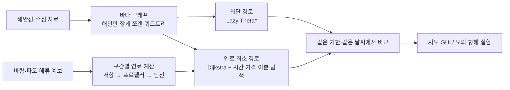

# OptimalShipRouting

**기상 예보를 반영해, 정해진 도착 기한 안에서 연료를 가장 적게 쓰는 선박 항로와 속력을 함께 찾는 프로그램입니다.**

출발지, 도착지, 출발 시각, 도착 기한을 넣으면 두 가지 항로를 계산해 지도에 그리고 비교합니다.

- **최단 경로:** 육지와 얕은 바다를 피하는, 거리가 가장 짧은 길
- **연료 최소 경로:** 바람, 파도, 해류 예보를 보고 길과 구간별 속력을 함께 고른 길

## 한눈에 보기

| 항목 | 내용 |
|---|---|
| 형태 | 개인 프로젝트 (2026년 10월 ~ 진행 중) |
| 언어·도구 | Python 3.11, Numba, NumPy, Shapely, Leaflet |
| 규모 | 커밋 220여 개, 자동 테스트 195개, 문제 해결 기록 50건 ([개발 기록](docs/devlog.md)) |
| 데이터 | 전부 무료 공개 자료 (ECMWF 예보, ERA5, Copernicus Marine, GEBCO 수심, OpenStreetMap) |
| 주요 결과 | 매일 새 예보로 다시 계획하면 같은 기한의 최단 경로보다 연료를 평균 0.98% 덜 씀 (30개 항해, 계획에 쓰지 않은 실제 날씨로 평가, 지각 0건) |
| 검증 | 해석해가 있는 문제 대비 오차 0.1% 이내, 공식 항구 간 거리표 대비 1% 안팎, 연료 모델 가정 4,609가지를 바꿔도 결론 유지 |
| 성능 | 약 2만 km 항해의 계획 1회 55분 → 5분 15초 (결과는 소수점까지 동일) |

이 프로젝트에서 보여 드리고 싶은 것은 세 가지입니다.

1. **단순한 버전부터 만들고, 실제로 생긴 문제를 측정한 뒤 고쳤습니다.** 모든 수정에 전후 수치가 있습니다.
2. **결과를 스스로 의심하고 바깥 기준으로 검증했습니다.** 그 과정에서 처음 숫자(최대 4.8% 절감)가 부풀려져 있었음을 직접 찾아 바로잡았습니다.
3. **결과를 바꾸지 않는 조건으로 성능을 개선했습니다.** 계산이 빨라져도 답이 한 자리도 달라지지 않게 했습니다.

## 시작하게 된 계기

항해 게임 「대항해시대」를 하다 보면 자동 항로가 이상한 길로 도는 경우가 있었습니다. 그걸 보면서 실제 바다에서는 최단 경로를 어떻게 찾는지 궁금해졌고, 생각이 이어지다 보니 "현실에서 가장 좋은 항로는 무엇인가"라는 질문까지 오게 됐습니다.

현실의 최적 항로는 단순한 최단 거리가 아닙니다. 지구는 구면이라 직선이 대권 항로가 되고, 바람과 파도는 시간에 따라 움직입니다. 그래서 악천후를 피해 돌아가거나, 속도를 높여 먼저 빠져나가거나, 속도를 늦춰 날씨가 지나간 뒤 도착하는 편이 연료를 덜 쓸 수 있습니다. 이 프로젝트는 그 판단을 프로그램이 하게 만드는 것이 목표입니다.

## 무엇을 하는가

- **최단 경로 탐색:** 육지와 수심 15 m 이하 바다를 지나지 않는 최단 길을 찾습니다. 수에즈·파나마 운하와 좁은 해협을 지나고, 경유지를 순서대로 거칠 수 있습니다.
- **연료 최소 경로 탐색:** 같은 도착 기한 안에서 길과 구간별 속력(12~24노트)을 함께 고릅니다. 배가 그 지점을 실제로 지나는 시각의 바람, 파도, 해류를 씁니다.
- **공정한 비교:** 두 경로를 같은 출발 시각, 같은 도착 기한, 같은 날씨에서 계산해 거리, 시간, 연료(t), 절감량을 보여 줍니다. 기한이 없으면 "천천히 가는 것"이 항상 이기기 때문에 기한을 입력으로 받습니다.
- **항해 중 재계획:** 예보는 15일까지만 나오고 뒤로 갈수록 틀립니다. 그래서 항해 중 매일 새 예보로 남은 길을 다시 계획하고, 이를 과거 예보 60일치로 처음부터 끝까지 모의 항해해 검증합니다.
- **지도 GUI:** 브라우저 지도에서 항구 이름을 넣거나 클릭해 출발지, 도착지, 경유지를 정하고, 두 경로를 다른 색으로 겹쳐 봅니다.
- **직접 만든 연료 모델:** 선박 제원에서 저항, 프로펠러, 엔진 출력, 시간당 연료를 계산합니다. 기본 선박은 공개 벤치마크 선형인 KCS(KRISO Container Ship)입니다.

## 어떻게 동작하는가



## 핵심 기술과 그렇게 고른 이유

| 영역 | 선택 | 이유 (측정으로 확인한 것) |
|---|---|---|
| 바다 지도 | 해안 근처만 약 1.7 km까지 쪼개는 쿼드트리 그래프 (약 96만 칸) | 균일 격자는 해협을 열려고 촘촘하게 하면 대양 탐색량이 함께 폭증했습니다 (0.25° → 0.1°에서 탐색 8초 → 57초). 대양은 0.25° 칸 그대로 두고 해안만 쪼개 해결했습니다. |
| 좁은 물길 | 운하·해협 4곳을 별도 링크로 연결 | 수에즈 운하는 폭이 수백 m라 어떤 격자로도 표현되지 않았습니다. OpenStreetMap의 운하 선과 분리통항로를 링크로 붙였습니다. |
| 얕은 바다 | GEBCO 수심 격자로 15 m 이하 통과 금지 | 수심 규칙 없이 찾은 부산→로테르담 최단 경로는 구간 1,516개 중 370개가 15 m 이하를 지났습니다. |
| 최단 경로 | Lazy Theta* (휴리스틱은 대권 거리) | 일반 A*는 칸 중심을 잇는 계단 거리로 길을 골라, 실제로는 더 짧은 해협을 놓쳤습니다. |
| 연료 경로 | 휴리스틱 없는 Dijkstra | 뒤바람을 받으면 연료가 잔잔한 바다보다 적게 들어, A*의 휴리스틱이 하한이 되지 못합니다. 구간 1,000만 개 중 15%가 그랬습니다 (최소 0.752배). |
| 도착 기한 | 시간에 가격을 매기고 가격을 이분 탐색 (라그랑주 완화) | 도착 시각을 탐색 상태에 넣었더니 상태 수가 폭발해 10분 안에 긴 항로가 하나도 끝나지 않았습니다. |
| 구면 기하 | 대권(haversine) 거리, 대권 호를 20 km 조각으로 나눠 육지 검사, 날짜변경선 연결 | 경위도 직선으로 검사하고 대권으로 거리를 세면 경로가 실제로는 육지를 111 km 지났습니다. |
| 연료 모델 | 모형 시험 저항의 실선 환산(ITTC-1978), 바람·파랑 부가저항(ITTC 권고 절차, SNNM), 제조사 공개 연비 | 경험식(Holtrop-Mennen)은 KCS에서 모형 시험보다 13~20% 크게 나왔습니다. 시험 자료가 있으면 시험값을 쓰고, 경험식은 시험 자료가 없는 배의 대체용으로 남겼습니다. |
| 성능 | 구간 연료 계산과 탐색을 Numba로 컴파일, 파랑 저항을 표로 미리 계산 | 순수 Python으로는 구간 하나에 48.5 ms가 걸려 긴 항로 탐색이 끝나지 않았습니다. |

## 주요 결과

### 연료 절감 (여름 30개 항해)

부산→LA, LA→부산, 부산→로테르담을 2026년 8~9월에 각 10번 출발시켜 모의 항해했습니다. 계획은 그때 나와 있던 ECMWF 예보로 하고, 평가는 계획에 쓰지 않은 실제 날씨(ERA5 재분석과 Copernicus Marine 해류)로 했습니다. 기준선은 같은 기한에 도착하는 최단 경로입니다.

| 항로 | 출발 때 한 번 계획 | 매일 재계획 | 날씨를 미리 다 안 경우 |
|---|---|---|---|
| 부산→LA | +0.11% | +0.55% | +0.47% |
| 부산→로테르담 | +0.10% | +0.50% | +1.16% |
| LA→부산 | +0.76% | +2.27% | +3.54% |
| 전체 | +0.28% | **+0.98%** | +1.64% |

- 매일 재계획한 30개 항해는 모두 기한 안에 도착했습니다.
- 매일 재계획은 "날씨를 미리 다 알았을 때" 얻는 절감의 약 60%를 예보만으로 얻었습니다.
- 한 번만 계획하면 예보가 틀린 항해에서 최단 경로보다 최대 5.06% 손해를 봤습니다. 같은 항해를 매일 재계획하면 4.05% 이득으로 바뀌었습니다.

절감률이 1% 안팎으로 작은 것은 기준선을 일부러 엄격하게 잡았기 때문입니다. 최단 경로도 날씨에 맞춰 속력을 나눠 쓰게 했고, 최단 경로 자체도 더 짧게 고쳤습니다. 그 전의 느슨한 기준으로는 최대 4.8%까지 나왔습니다(아래 "숫자를 의심하고 바로잡은 과정").

### 검증

| 무엇을 | 어떻게 | 결과 |
|---|---|---|
| 탐색기가 최적에 가까운가 | 정답을 식으로 구할 수 있는 제르멜로 항법 문제에 계획기를 넣음 | 정답 대비 +2~4% → **+0.1% 이내** |
| 기한 맞추기 방식이 놓치는 해 | 느리지만 정확한 탐색을 따로 만들어 비교 | 차이 중앙값 0.03% (합성 14건), 0.295% (실제 예보 11건) |
| 최단 경로 거리 | 미국 NGA 공식 항구 간 거리표(Pub.151)와 비교 | 부산–LA −0.15%, 부산–로테르담 −1.02%, 싱가포르–로테르담 −1.11% |
| 연료 모델의 가정 | 불확실한 입력 7개를 범위 안에서 바꾼 선박 모델 4,609개로 재계산 | 모든 묶음에서 결론의 부호가 99.8% 이상 유지 |
| 예보 자료의 정확도 | 위성 고도계 파고 880만 건, 부이 24곳과 비교 | 파고 상관 0.985 (하루 이내) → 0.79 (6~10일) |

로테르담–뉴욕은 거리표보다 3.96% 짧게 나왔습니다. 원인을 추적하니 거리표는 빙산을 피해 그랜드뱅크스 남쪽으로 도는 항로였고, 같은 지점을 경유지로 넣으면 −1.62%가 됐습니다. 얼음을 모른다는 것은 지금 모델의 한계로 남겨 두었습니다.

### 성능

| 대상 | 전 | 후 |
|---|---|---|
| 구간 하나의 연료 계산 | 48.5 ms | 약 1.5 µs |
| 지나는 시각의 날씨를 쓰는 탐색 (부산→LA) | 529초 | 20.6초 |
| 경로 펴기 (부산→로테르담) | 815초 | 14.9초 |
| 계획 1회 (부산→로테르담, 약 2만 km) | 55분 | 5분 15초 |

## 문제 해결 사례

전체 50건은 [개발 기록](docs/devlog.md)에 접근 → 문제(측정값) → 원인 → 해결 → 전후 비교 순서로 남겼습니다. 대표적인 것만 추렸습니다.

### 1. 가장 단순한 격자로 시작했더니 부산→LA가 지구를 한 바퀴 돌았다

위경도 0.25° 격자와 8방향 A*로 시작했습니다. 부산→LA가 31,493 km(대권 거리의 3.3배)로 나왔고, 흑해는 고립됐고, 부산→로테르담은 희망봉으로 돌았습니다. 원인을 하나씩 분리해 고쳤습니다. 격자가 날짜변경선에서 끊겨 있었고, 좁은 해협은 칸 중심이 물 위에 떨어지지 않았고, 운하는 격자로 표현할 수 없었고, 대각선 이동이 육지를 최대 73 km 가로질렀습니다.

결과적으로 부산→LA는 31,493 km → 9,669.9 km(공식 거리표 대비 −0.15%), 부산→로테르담은 27,062 km → 19,874.8 km(수에즈 경유)가 됐습니다.

### 2. 연료 탐색이 5분 안에 끝나지 않았다

연료를 비용으로 넣자 긴 항로 4개가 모두 시간 제한에 걸렸습니다. 추측하지 않고 프로파일링했더니 시간의 99%가 파랑 부가저항 계산(규칙파 7,280번의 합)에 들어가고 있었습니다. 파랑 저항이 유의파고의 제곱에 정확히 비례한다는 점을 이용해 주기와 파향의 표로 미리 계산했고(오차 중앙값 0.15%), 남은 병목인 예보 보간은 배열 연산과 Numba로 옮겼습니다. 구간당 48.5 ms가 1.5 µs가 됐고, 끝나지 않던 부산→로테르담 탐색이 9.9초에 끝났습니다.

### 3. A*가 최적을 보장하지 못한다는 것을 측정으로 확인했다

지브롤터 구간에서 날씨를 넣은 연료(31.17 t)가 잔잔한 바다 연료(31.55 t)보다 적게 나온 것이 단서였습니다. 뒤바람이 공기저항을 줄여 주기 때문입니다. 전체 구간을 세어 보니 15%가 잔잔한 바다보다 연료가 적어서, "남은 거리 × 잔잔한 바다 연료"는 하한이 아니었습니다. 휴리스틱을 뺀 Dijkstra로 바꿨고, 칸마다 휴리스틱을 계산하지 않아 가장 긴 항로에서는 오히려 빨랐습니다(10.2초 → 5.5초).

### 4. 도착 시각을 탐색 상태에 넣자 탐색이 폭발했다

같은 칸이라도 언제 도착했는지에 따라 만나는 날씨가 다르므로, 처음에는 (칸, 도착 시각)을 상태로 삼았습니다. 10분 동안 상태 160만~190만 개를 확장하고도 긴 항로가 하나도 끝나지 않았고, 시각을 1시간 단위로 묶은 탓에 있는 해도 놓쳤습니다. 시각을 상태에서 빼고 "연료 + 가격 × 시간"을 최소화하도록 바꾼 뒤, 기한에 맞는 가격을 이분 탐색했습니다. 모든 항로가 기한을 지키는 답을 냈습니다. 이 방식이 놓치는 해가 얼마나 되는지는 정확한 탐색을 따로 만들어 쟀습니다(차이 중앙값 0.03~0.3%).

### 5. 숫자를 의심하고 바로잡은 과정

처음 모의 항해에서는 최단 경로 대비 0.7~4.8% 절감이 나왔습니다. 하지만 계획도 평가도 같은 예보로 한 숫자였기 때문에 세 가지를 다시 확인했습니다.

- **평가 날씨:** 계획에 쓰지 않은 독립 자료로 평가하자 50개 항해 중 36개가 기한보다 늦게 도착했습니다. 늦게 가면 연료는 당연히 줄기 때문에 비교가 성립하지 않았습니다. 모든 계획을 같은 도착 시각으로 맞춰 다시 쟀더니 평균 절감이 2.40% → 1.43%가 됐습니다.
- **기준선:** 연료 최소 경로가 "최단 경로"보다 83 km 짧은 경우를 발견했습니다. A*가 칸 중심을 잇는 계단 거리로 비교해서, 칸이 잘게 나뉜 쓰가루 해협이 실제보다 길어 보였던 것입니다. Lazy Theta*로 바꿔 부산→LA 최단 경로가 9,757.1 km → 9,675.9 km가 됐습니다.
- **정직한 숫자:** 기준선이 엄격해진 만큼 절감률은 내려갔습니다. 대신 지금의 +0.98%는 공정한 비교에서 나온 값이고, 연료 사용량 자체는 지금 코드가 가장 적습니다.

### 6. 결과를 한 자리도 바꾸지 않고 9배 빠르게

2만 km 항해의 계획 한 번에 55분이 걸렸습니다. "경로, 속력, 연료가 한 자리도 바뀌면 안 된다"를 조건으로 걸었습니다. 그래야 그동안 잰 실험을 다시 돌리지 않아도 되기 때문입니다. 단계별로 시간을 재서 큰 덩어리부터 줄였고(반복되는 시간 위치 찾기 제거, 여러 코어 병렬화, 탐색 컴파일), 5분 15초가 됐습니다. 30개 항해를 다시 계획해 결과가 0.01 t 안에서 같은 것을 확인했습니다.

결과가 조금 달라지는 것을 허용하면 5분 안에 들어오는 방법도 찾았지만, 얻는 시간이 측정 잡음 범위였고 모든 실험을 다시 돌려야 해서 적용하지 않았습니다.

## 한계와 남은 일

- KCS는 실제로 건조된 배가 아니어서 엔진과 일부 추진 계수는 가정값입니다. 그래서 절감률은 같은 연료 모델 안의 상대 비교이고, 절대 연료(t)는 추정값입니다. 가정값의 출처는 `src/shiprouting/fuel/ships.py`에 적었습니다.
- 해빙과 빙산 자료가 없습니다. 북위 72° 이북과 남위 60° 이남은 막아 두었습니다.
- 검증은 여름(태풍 철) 30개 항해까지 했습니다. 사전에 등록한 [실험 계획](docs/experiment-plan.md)의 겨울철과 대서양 항로는 아직 남아 있습니다.
- 가장 긴 항로의 계획 1회는 약 6분으로, 목표인 5분을 조금 넘습니다.
- GEBCO 수심은 항해용 자료가 아닙니다. 이 프로그램의 경로는 연구·학습용이며 실제 항해에 쓸 수 없습니다.

## 기술 스택

| 구분 | 사용 |
|---|---|
| 언어 | Python 3.11 이상 |
| 수치 계산 | NumPy, Numba (JIT 컴파일, `prange` 병렬), SciPy |
| 공간 자료 | Shapely, pyogrio (육지 폴리곤), h5py (GEBCO netCDF) |
| 기상 자료 | ecCodes (GRIB2), ecmwf-opendata, copernicusmarine, Zarr 형식의 ERA5 |
| GUI | Python 표준 라이브러리 HTTP 서버, Leaflet 지도 |
| 테스트 | pytest (195개) |

## 설치와 실행

```bash
python -m venv .venv
source .venv/bin/activate        # Windows: .venv\Scripts\activate
pip install -e '.[dev,weather,sea]'
pytest
```

테스트는 내려받은 자료 없이 돌아갑니다(약 3~4분). 실제 경로를 계산하려면 아래 자료가 필요합니다. 용량이 커서 `data/`에 두고 깃에는 올리지 않습니다.

| 자료 | 받는 곳 | 쓰는 곳 |
|---|---|---|
| 육지 폴리곤 (`land-polygons-split-4326`) | osmdata.openstreetmap.de | 첫 번째 인자 `land` |
| 운하·해협 선 (Overpass JSON) | OpenStreetMap Overpass API, 파일 이름은 `sea/links.py`의 `LINKS` | `--links` |
| GEBCO 수심 격자 (netCDF) | gebco.net | `--bathymetry` |
| ECMWF 예보 (GRIB2) | 아래 `ecmwf.download` | `forecast`, `runs` |

예보 받기:

```python
from datetime import datetime
from shiprouting.weather import ecmwf

run = datetime(2026, 10, 22, 0)
steps = [*range(0, 144, 3), *range(144, 361, 6)]
ecmwf.download(run, steps=steps, target_dir="data/weather/ecmwf/2026102200")
```

ECMWF 서버는 최근 며칠치만 보관합니다. 더 오래된 예보는 `source="aws"`나 `"google"`로 받습니다.

항해 하나 계획하기 (부산→LA):

```bash
python -m shiprouting.route.plan data/sea/land_polygons.shp "data/weather/ecmwf/2026102200/*.grib2" out/busan_la.json \
    --start 35.08,129.08 --goal 33.72,-118.27 \
    --departure 2026-10-22T00:00 --deadline 2026-11-06T12:00 \
    --links data/sea/osm --bathymetry data/bathymetry/GEBCO_2026.nc \
    --graph data/cache/graph.npz --tables data/cache/waves
```

바다 그래프는 처음 한 번 만들 때 몇 분이 걸리고, `--graph` 파일에 저장해 다음부터 다시 씁니다. 메모리는 16 GB 이상을 권장합니다.

지도 GUI:

```bash
python -m shiprouting.gui.server data/sea/land_polygons.shp data/weather/ecmwf \
    --links data/sea/osm --bathymetry data/bathymetry/GEBCO_2026.nc \
    --graph data/cache/graph.npz --tables data/cache/waves --port 8000
```

`data/weather/ecmwf` 아래에 예보를 `YYYYMMDDHH` 폴더별로 두면, 출발 시각에 맞는 가장 새 예보를 골라 씁니다. 실행 후 브라우저에서 `http://localhost:8000`을 엽니다.

## 저장소 구조

```
src/shiprouting/
  fuel/      연료 모델: 저항(모형 시험 환산, Holtrop-Mennen), 프로펠러, 엔진, 바람·파랑 부가저항, 불확실성 분석
  sea/       바다 지도: 육지, 수심, 쿼드트리 그래프, 운하·해협 링크, 최단 경로 탐색
  weather/   기상 자료: ECMWF 예보, ERA5, Copernicus Marine 해류, 보간
  route/     경로 계획: 연료 탐색 커널, 속력 선택, 급선회 다듬기, 항해 재계획, 평가기, 검증용 정확 탐색·제르멜로
  gui/       지도 GUI (로컬 웹 서버 + Leaflet 페이지)
scripts/     실험 실행, 관측 비교, 검증 스크립트
experiments/ 사전 등록한 실험 시나리오
docs/        개발 기록(devlog.md), 실험 계획(experiment-plan.md)
tests/       자동 테스트
```

## 데이터 출처

- **기상 예보:** This service is based on data and products of the European Centre for Medium-Range Weather Forecasts (ECMWF). Source: www.ecmwf.int. 라이선스: [CC BY 4.0](https://creativecommons.org/licenses/by/4.0/). ECMWF does not accept any liability whatsoever for any error or omission in the data, their availability, or for any loss or damage arising from their use. 이 프로젝트는 원자료를 시공간 보간하고 파 주기를 변환해서 씁니다.
- **재분석 (평가용 실제 날씨):** ERA5, Copernicus Climate Change Service (C3S). Google Cloud의 공개 사본 ARCO-ERA5에서 받았습니다. Contains modified Copernicus Climate Change Service information.
- **해류·위성 파고:** E.U. Copernicus Marine Service Information.
- **수심:** GEBCO Compilation Group (2026) GEBCO 2026 Grid. GEBCO 격자는 항해용이 아니며(not to be used for navigation), 이 프로젝트는 GEBCO, IHO, IOC와 관계가 없습니다.
- **해안선·운하·분리통항로·지도 타일:** © OpenStreetMap contributors, [ODbL](https://opendatacommons.org/licenses/odbl/).
- **거리 비교 기준:** NGA Pub. 151, Distances Between Ports.
- **부이 관측:** NOAA National Data Buoy Center (NDBC).
- **선박:** KCS 선형과 모형 시험 자료는 공개 벤치마크(Tokyo 2015 CFD Workshop) 자료입니다.
